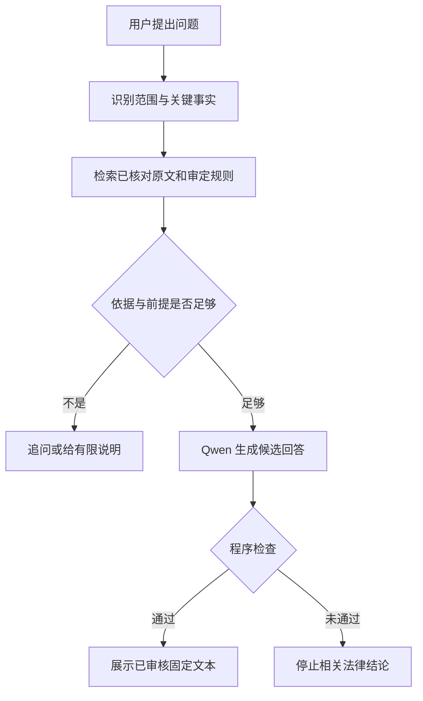

# 回答流程与停止条件

实际能否执行此流程，以宿主调用、程序返回和测试证据为准。

程序实现的检查点：支持场景与受限功能、紧急安全分流、问题文字与所选场景的唯一关键词对应、已审定规则及审核记录、来源与条文校验、事件日期和地区、规则所需事实与机器可检查的已审事实模式、候选正文与已审文本逐字一致。结构化多轮记录只接受用户事实更新或撤回；更正后的事实重新匹配规则，超出审核模式即停止结论。提供已审规则编号后，若问题文字没有唯一命中所选场景，程序先要求补充或确认，不显示固定文本。这是保守的字面检查：它可能拦下本来可以回答的问题，也不能理解同义词或保证宿主准确提取事实。缺少任何一环都不能返回 `ANSWER`。候选或审核状态由调用方声称并不构成证明；尤其不能从候选的自评字段推断其已经被专业审核。程序也不能自行证明宿主把自由文本中的事实准确整理成结构化记录。

当前 `rules/approved/` 为空，所有十二个场景都到不了“依据与前提足够”后的公开法律解释分支。运行时若无已配置的 Qwen，也停止候选回答分支。普通 Skill 宿主若不能强制执行脚本，只可提供事实整理、关键追问和官方法源入口，不能宣称已经完成程序检查。

宿主显示约束：除紧急情况外，每次先运行 `answer.py`。结果为 `ANSWER` 时只能展示程序返回的已审文本；其他状态只能原样展示程序返回的有限说明和实际状态，不再根据参考文件、模型记忆或“常识”续写。尤其在 `PENDING_REVIEW` 时，不能用“更像借款／投资”、转账能证明什么、押金应退时间起点等形式补充结论；先确认转账方向等未明事实。参考文件的场景表只用于选择输入，不能成为独立的法律结论来源。
